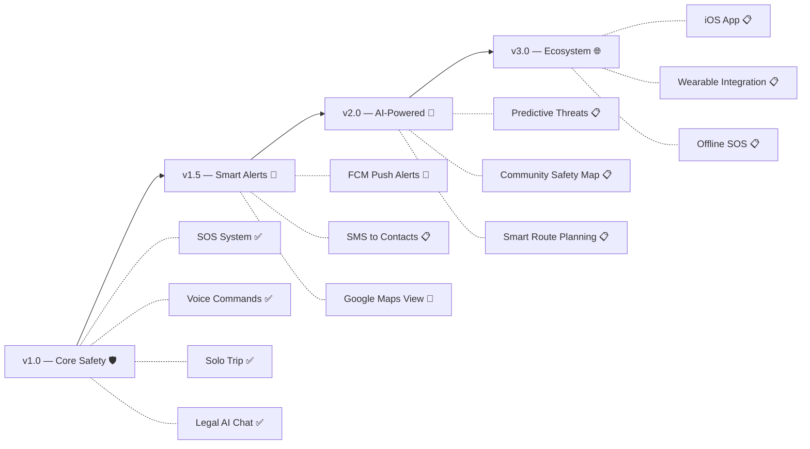

<p align="center">
  
</p>

<h1 align="center">🛡️ DURGA — SafeConnect</h1>

<p align="center">
  <strong>AI-Powered Women's Safety & Emergency Response Platform</strong>
</p>

<p align="center">
  <em>Empowering safety through technology — one tap, one voice, one shield.</em>
</p>

<p align="center">
  <a href="https://flutter.dev"></a>
  <a href="https://dart.dev"></a>
  <a href="https://supabase.com"></a>
  <a href="https://ai.google.dev"></a>
  <a href="#"></a>
  <a href="#"></a>
  <a href="https://github.com/GangaNimesh/Durga/tree/chaiLoversBranch"></a>
</p>

<p align="center">
  <a href="#-features">Features</a> •
  <a href="#-architecture">Architecture</a> •
  <a href="#-tech-stack">Tech Stack</a> •
  <a href="#-getting-started">Getting Started</a> •
  <a href="#-project-structure">Project Structure</a> •
  <a href="#-roadmap">Roadmap</a> •
  <a href="#-contributing">Contributing</a>
</p>

---

## 📋 Table of Contents

- [Overview](#-overview)
- [Why DURGA?](#-why-durga)
- [Features](#-features)
  - [SOS Emergency System](#-sos-emergency-system)
  - [Voice Command & Wake Word](#-voice-command--wake-word)
  - [Solo Trip Guardian](#-solo-trip-guardian)
  - [AI Legal Rights Assistant](#-ai-legal-rights-assistant)
  - [Fake Call Escape](#-fake-call-escape)
  - [Nearby Emergency Services](#-nearby-emergency-services)
  - [Evidence Collection](#-evidence-collection)
  - [Safety Notifications & Widgets](#-safety-notifications--widgets)
  - [Multi-Language Support](#-multi-language-support)
- [Screenshots](#-screenshots)
- [Architecture](#-architecture)
- [Tech Stack](#-tech-stack)
- [Getting Started](#-getting-started)
- [Environment Variables](#-environment-variables)
- [Project Structure](#-project-structure)
- [Feature Status](#-feature-status)
- [Roadmap](#-roadmap)
- [Contributing](#-contributing)
- [License](#-license)
- [Acknowledgements](#-acknowledgements)

---

## 🌟 Overview

**DURGA — SafeConnect** is a comprehensive, AI-powered women's safety application built with Flutter. It goes beyond a simple SOS button — combining **real-time voice commands**, **on-device wake word detection**, **AI-driven legal assistance**, **solo trip monitoring**, **silent evidence recording**, and **deep Android OS integration** into a single, beautifully designed platform.

Whether it's a one-tap SOS from the lock screen, a voice-activated emergency trigger by saying _"Hey Durga, help!"_, or a discreet fake call to escape an uncomfortable situation — DURGA is designed to be the safety companion that's always within reach.

> **Named after the Hindu goddess Durga** — a symbol of strength, protection, and the destruction of evil — this app embodies her spirit in digital form.

---

## 💡 Why DURGA?

| Problem | DURGA's Solution |
|---|---|
| Emergencies don't wait for you to unlock your phone | **Quick Settings SOS Tile** + **Home Screen Widget** — trigger SOS without even opening the app |
| Typing is impossible during panic | **Voice commands** in English, Hindi & Telugu — just say _"bachao"_ (save me) |
| You can't always reach your phone | **Wake word detection** — _"Hey Durga"_ activates hands-free, always-on listening |
| Women often don't know their legal rights | **AI Legal Assistant** powered by Gemini 2.0 with a comprehensive Indian women's legal knowledge base |
| Solo travel feels unsafe | **Solo Trip Guardian** with timed check-ins and auto-alerts if you don't respond |
| Need to escape a situation discreetly | **Fake Call** simulates a realistic incoming call |
| Evidence disappears | **Silent audio/video recording** + cloud evidence storage via Supabase |
| One language doesn't fit all | **Trilingual support** — English, Hindi (हिन्दी), Telugu (తెలుగు) |

---

## ✨ Features

### 🚨 SOS Emergency System

The core of DURGA — a multi-layered emergency response system accessible from **anywhere on your device**.

- **One-Tap SOS** — Large, prominent emergency button on the home dashboard
- **Quick Settings Tile** — SOS button in Android's notification shade (no app unlock needed)
- **Home Screen Widget** — Persistent SOS widget on your home screen with voice & call shortcuts
- **Voice-Activated SOS** — Say _"help"_, _"emergency"_, _"bachao"_, or _"SOS"_ to trigger
- **Wake Word SOS** — _"Hey Durga, help!"_ triggers SOS hands-free
- **Emergency Helplines** — One-tap dial to **112** (National Emergency) and **181** (Women Helpline)
- **Location Sharing** — Automatically shares GPS coordinates with emergency contacts
- **SOS History** — Full log of past SOS events with timestamps and resolution status

### 🎙️ Voice Command & Wake Word

Hands-free safety powered by on-device AI — no internet required for wake word detection.

- **Always-On Wake Word** — _"Hey Durga"_ activates the voice command system using on-device ONNX models (openWakeWord)
- **12+ Voice Intents** supported:

  | Command | Action |
  |---|---|
  | _"Help" / "SOS" / "Bachao" / "Emergency"_ | Triggers SOS alert |
  | _"Call police" / "Police ko call karo"_ | Dials 100 |
  | _"Women helpline" / "Mahila helpline"_ | Dials 181 |
  | _"Fake call" / "Natak call"_ | Launches fake incoming call |
  | _"Share location" / "Location bhejo"_ | Shares GPS with contacts |
  | _"Start recording" / "Recording shuru karo"_ | Begins silent recording |
  | _"Solo trip" / "Safe trip"_ | Opens solo trip screen |
  | _"Legal help" / "Kanoon"_ | Opens AI legal chat |
  | _"Nearby hospital" / "Police station"_ | Shows nearby services |

- **Bilingual Keywords** — Commands work in **English**, **Hindi**, and **Telugu**
- **Voice Feedback** — Spoken confirmations via text-to-speech
- **Voice Log** — Complete history of all recognized commands with confidence scores
- **Beautiful Overlay UI** — Glassmorphic voice command interface with live waveform visualization

### 🗺️ Solo Trip Guardian

Never travel alone without a safety net.

- **Trip Setup** — Enter destination, select travel mode (🚶 Walk / 🚗 Drive / 🚇 Transit / 🚕 Ride)
- **Timed Check-Ins** — Configurable intervals (15 / 30 / 45 / 60 minutes)
- **Live Dashboard** — Elapsed time, distance traveled, next check-in countdown, GPS coordinates
- **Auto-Alert** — If you miss a check-in, trusted contacts are notified
- **Trip Controls** — Check in, pause/resume, end trip, or trigger SOS mid-trip
- **Trip History** — Complete log of past trips with status, duration, and distance
- **Active Trip Indicator** — Pulsing green dot on the navigation dock when a trip is live
- **Supabase-Backed** — All trip data synced to the cloud with Haversine distance calculation

### ⚖️ AI Legal Rights Assistant

Know your rights — powered by **Google Gemini 2.0 Flash** and a comprehensive Indian women's legal knowledge base.

- **378-Line Legal Guide** covering:
  -  Filing FIRs and Zero FIRs
  -  Protection of Women from Domestic Violence Act, 2005
  -  Sexual Harassment at Workplace Act, 2013 (PoSH)
  -  Dowry Prohibition Act, 1961
  -  Key IPC / BNS Sections for women's safety
  -  Cyber Harassment & IT Act
  -  POCSO Act, 2012
  -  Maintenance & Alimony Rights
  -  Legal Aid & Free Counsel
  -  National Commission for Women (NCW)
  -  Emergency Helplines & Resources
- **Contextual AI Chat** — Multi-turn conversations with Gemini understanding your situation
- **Suggested Questions** — Pre-built prompts like _"How do I file an FIR?"_ and _"What are my workplace harassment rights?"_
- **Bilingual Responses** — AI responds in your preferred language
- **Legal Response Cards** — Beautifully formatted cards with section references and action items

### 📞 Fake Call Escape

A discreet escape mechanism that simulates a realistic incoming phone call.

- **Realistic Call UI** — Mimics Android's native incoming call screen
- **Animated Caller Avatar** — Pulsing ring animation for authenticity
- **Slide to Answer** — Realistic swipe gesture to accept the call
- **Connected Call Timer** — Shows elapsed call time after answering
- **Call Controls** — Speaker, mute, and keypad buttons for realism
- **Voice-Activated** — Trigger via _"fake call"_ or _"natak call"_ voice command
- **Full-Screen Overlay** — Looks exactly like a real phone call

### 📍 Nearby Emergency Services

Find help around you — powered by OpenStreetMap's Overpass API.

- **Service Categories** — Police stations, hospitals, fire stations, women's police stations
- **Distance-Sorted** — Results ordered by proximity (nearest first)
- **Google Maps Directions** — One-tap navigation to any service
- **Telugu Translations** — Localized station names and types
- **5km Search Radius** — Comprehensive coverage area
- **Offline Fallback** — Hardcoded Hyderabad police stations when API is unavailable
- **Haversine Formula** — Accurate distance calculations on Earth's surface

### 📹 Evidence Collection

Capture and preserve evidence when it matters most.

- **Silent Audio Recording** — Record audio discreetly in the background
- **Instant Video** — One-tap video capture with camera preview
- **Cloud Upload** — Evidence stored securely via Supabase Storage
- **Timestamped Files** — Automatic naming with date/time for legal validity
- **Background Operation** — Recording continues even when the screen is off
- **Evidence History** — List, view, and manage all captured evidence

### 🔔 Safety Notifications & Widgets

Always-on protection that integrates deeply with Android OS.

- **Persistent Shield Notification** — _"DURGA Shield Active"_ notification with SOS quick-action button
- **Foreground Service** — Keeps DURGA alive in the background for reliable protection
- **Quick Settings SOS Tile** — Instant SOS from Android's Quick Settings panel
- **Home Screen Widget** — Permanent SOS + Voice + Call buttons on your home screen
- **Boot Persistence** — Services restart automatically after device reboot
- **Battery Optimization Bypass** — Requests exemption for uninterrupted protection

### 🌐 Multi-Language Support

Safety in your mother tongue.

- **English** — Full UI and voice commands
- **Hindi (हिन्दी)** — Voice commands: _"bachao"_, _"madad"_, _"khatara"_, _"police ko call karo"_
- **Telugu (తెలుగు)** — Voice commands and localized emergency service names
- **Persistent Preference** — Language selection saved across app restarts
- **Language Toggle** — Easy switcher in the app header

---

## 🏗️ Architecture

```
┌─────────────────────────────────────────────────────────────┐
│                    DURGA SafeConnect                        │
├─────────────────────────────────────────────────────────────┤
│                                                             │
│  ┌──────────────────── Presentation ─────────────────────┐  │
│  │  Screens        Widgets        Overlays       Theme   │  │
│  │  ┌──────────┐  ┌───────────┐  ┌────────────┐  ┌───┐  │  │
│  │  │HomeScreen│  │ SOS Card  │  │VoiceOverlay│  │Dark│  │  │
│  │  │SoloTrip  │  │ Chat View │  │            │  │Mode│  │  │
│  │  │LegalChat │  │ Dock Nav  │  │            │  │    │  │  │
│  │  │FakeCall  │  │ Onboard   │  │            │  │    │  │  │
│  │  └──────────┘  └───────────┘  └────────────┘  └───┘  │  │
│  └───────────────────────────────────────────────────────┘  │
│                            │                                │
│  ┌──────────────────── State Management ─────────────────┐  │
│  │              Provider (ChangeNotifier)                 │  │
│  │         AuthProvider    LocaleProvider                 │  │
│  └───────────────────────────────────────────────────────┘  │
│                            │                                │
│  ┌──────────────────── Services Layer ───────────────────┐  │
│  │  ┌─────────────┐ ┌──────────────┐ ┌───────────────┐  │  │
│  │  │   Voice      │ │  Solo Trip   │ │  Legal Chat   │  │  │
│  │  │  Command     │ │  Service     │ │  Service      │  │  │
│  │  │  Service     │ │              │ │  (Gemini AI)  │  │  │
│  │  └─────────────┘ └──────────────┘ └───────────────┘  │  │
│  │  ┌─────────────┐ ┌──────────────┐ ┌───────────────┐  │  │
│  │  │  Wake Word  │ │   Nearby     │ │   Safety      │  │  │
│  │  │  Service    │ │  Emergency   │ │ Notification  │  │  │
│  │  │  (ONNX)     │ │  Service     │ │  Service      │  │  │
│  │  └─────────────┘ └──────────────┘ └───────────────┘  │  │
│  │  ┌─────────────┐ ┌──────────────┐ ┌───────────────┐  │  │
│  │  │  Silent     │ │   Widget     │ │   Supabase    │  │  │
│  │  │  Recorder   │ │   Service    │ │   Service     │  │  │
│  │  └─────────────┘ └──────────────┘ └───────────────┘  │  │
│  └───────────────────────────────────────────────────────┘  │
│                            │                                │
│  ┌──────────────────── Native Layer ─────────────────────┐  │
│  │  Android (Kotlin)                                     │  │
│  │  ┌──────────────┐ ┌────────────┐ ┌────────────────┐  │  │
│  │  │ MainActivity │ │ SOS Tile   │ │ Widget Provider│  │  │
│  │  │ (MethodChan) │ │ (QS Tile)  │ │ (AppWidget)   │  │  │
│  │  └──────────────┘ └────────────┘ └────────────────┘  │  │
│  └───────────────────────────────────────────────────────┘  │
│                            │                                │
│  ┌──────────────────── External Services ────────────────┐  │
│  │  Supabase (Auth + DB + Storage)                       │  │
│  │  Google Gemini 2.0 Flash (Legal AI)                   │  │
│  │  Overpass API / OpenStreetMap (Nearby Services)       │  │
│  │  openWakeWord ONNX Models (On-Device Wake Word)      │  │
│  └───────────────────────────────────────────────────────┘  │
└─────────────────────────────────────────────────────────────┘
```

---

## 🛠️ Tech Stack

### Core Framework
| Technology | Purpose |
|---|---|
| **Flutter 3.x** | Cross-platform UI framework |
| **Dart 3.x** | Programming language |
| **Material Design 3** | Design system |
| **Provider** | State management |

### Backend & Cloud
| Technology | Purpose |
|---|---|
| **Supabase** | Authentication, PostgreSQL database, file storage |
| **Google Gemini 2.0 Flash** | AI-powered legal assistant |
| **Overpass API** | Nearby emergency service discovery |

### AI & ML (On-Device)
| Technology | Purpose |
|---|---|
| **openWakeWord** | Always-on wake word detection via ONNX |
| **ONNX Runtime** | On-device model inference |
| **speech_to_text** | Real-time speech recognition |
| **flutter_tts** | Text-to-speech voice feedback |

### Native Android
| Technology | Purpose |
|---|---|
| **Kotlin** | Native Android components |
| **TileService** | Quick Settings SOS tile |
| **AppWidgetProvider** | Home screen widget |
| **Foreground Service** | Background safety monitoring |
| **Method Channels** | Flutter ↔ Android communication |

### Key Packages

<details>
<summary>📦 Click to expand full dependency list</summary>

| Package | Version | Purpose |
|---|---|---|
| `supabase_flutter` | ^2.8.0 | Cloud backend (auth, DB, storage) |
| `google_generative_ai` | ^0.4.7 | Gemini AI integration |
| `speech_to_text` | ^7.4.0 | Voice recognition |
| `flutter_tts` | ^4.2.5 | Text-to-speech |
| `geolocator` | ^11.1.0 | GPS positioning |
| `geocoding` | ^3.0.0 | Reverse geocoding |
| `google_maps_flutter` | ^2.9.0 | Map integration |
| `camera` | ^0.11.2+1 | Video recording |
| `record` | ^5.2.1 | Audio recording |
| `flutter_local_notifications` | ^19.5.0 | Notification management |
| `flutter_foreground_task` | ^9.2.2 | Foreground service |
| `home_widget` | ^0.7.0 | Home screen widget bridge |
| `flutter_contacts` | ^1.1.9+2 | Device contact access |
| `provider` | ^6.1.5 | State management |
| `dio` | ^5.7.0 | HTTP client |
| `flutter_secure_storage` | ^9.2.4 | Secure token storage |
| `share_plus` | ^10.1.4 | System share sheet |
| `permission_handler` | ^11.3.1 | Runtime permissions |
| `flutter_animate` | ^4.5.0 | Declarative animations |
| `flutter_svg` | ^2.0.10+1 | SVG rendering |
| `google_fonts` | ^6.2.1 | Typography |
| `font_awesome_flutter` | ^10.7.0 | Icon library |
| `flutter_dotenv` | ^6.0.1 | Environment config |
| `uuid` | ^4.5.1 | Unique ID generation |
| `intl` | ^0.19.0 | Internationalization |
| `url_launcher` | ^6.3.0 | External app launching |
| `shared_preferences` | ^2.3.2 | Local key-value storage |
| `image_picker` | ^1.1.2 | Photo/video capture |
| `path_provider` | ^2.1.5 | File system paths |
| `open_file` | ^3.5.10 | File opening |
| `open_wake_word` | local | On-device wake word detection |

</details>

---

## 🚀 Getting Started

### Prerequisites

- **Flutter SDK** 3.x ([Install Flutter](https://docs.flutter.dev/get-started/install))
- **Dart SDK** 3.x (included with Flutter)
- **Android Studio** or **VS Code** with Flutter extension
- **Android device or emulator** (API 21+)
- **Supabase account** ([Sign up free](https://supabase.com))
- **Google AI Studio API key** ([Get API key](https://aistudio.google.com/apikey))

### Installation

1. **Clone the repository**

   ```bash
   git clone https://github.com/GangaNimesh/Durga.git
   cd Durga
   ```

2. **Create your environment file**

   ```bash
   cp .env.example .env
   ```

   Edit `.env` with your credentials (see [Environment Variables](#-environment-variables)).

3. **Install dependencies**

   ```bash
   flutter pub get
   ```

4. **Run the app**

   ```bash
   flutter run
   ```

### Quick Run (All-in-One)

```bash
# VS Code: Ctrl+Shift+B (Cmd+Shift+B on macOS) → "Start Everything"
# CLI:
./run_all.sh          # macOS/Linux
run_all.bat           # Windows
```

---

## 🔐 Environment Variables

Create a `.env` file in the project root:

```env
# Supabase Configuration
SUPABASE_URL=https://your-project.supabase.co
SUPABASE_ANON_KEY=your-anon-key

# Google Gemini AI (for Legal Chat)
GEMINI_API_KEY=your-gemini-api-key

# Google Maps (optional — for map rendering)
MAPS_API_KEY=your-maps-api-key
```

> ⚠️ **Never commit your `.env` file.** It is listed in `.gitignore` by default.

---

## 📁 Project Structure

```
durga/
├── android/
│   └── app/src/main/
│       ├── kotlin/com/arun/durga/durga/
│       │   ├── MainActivity.kt              # Method channel + native integration
│       │   ├── DurgaSosTileService.kt        # Quick Settings SOS tile
│       │   └── DurgaWidgetProvider.kt        # Home screen widget provider
│       ├── res/
│       │   ├── drawable/                     # Widget & notification icons
│       │   ├── layout/durga_widget.xml       # Widget layout
│       │   ├── xml/durga_widget_info.xml     # Widget metadata
│       │   └── values/strings.xml            # String resources
│       └── AndroidManifest.xml               # Permissions & components
│
├── assets/
│   ├── images/                               # App images & illustrations
│   ├── icons/                                # Custom icons
│   ├── legal/
│   │   └── indian_women_legal_guide.md       # 378-line comprehensive legal guide
│   └── wake_word/
│       ├── melspectrogram.onnx               # Audio feature extraction model
│       ├── embedding_model.onnx              # Audio embedding model
│       └── hey_jarvis.onnx                   # Wake word classifier model
│
├── lib/
│   ├── main.dart                             # App entry point & initialization
│   │
│   ├── models/
│   │   ├── app_models.dart                   # Core data models
│   │   └── auth_models.dart                  # Authentication models
│   │
│   ├── providers/
│   │   ├── auth_provider.dart                # Auth state management
│   │   └── locale_provider.dart              # Language/locale management
│   │
│   ├── screens/
│   │   ├── new_home_screen.dart              # Main dashboard
│   │   ├── onboarding_screen.dart            # Onboarding & auth flow
│   │   ├── solo_trip_screen.dart             # Solo trip guardian
│   │   ├── legal_chat_screen.dart            # AI legal assistant
│   │   ├── fake_call_screen.dart             # Fake call simulation
│   │   ├── safety_profile_screen.dart        # Safety profile setup
│   │   ├── profile_screen.dart               # User profile & settings
│   │   ├── safezone_screen.dart              # Journey tracking
│   │   ├── contact_picker_screen.dart        # Trusted contact picker
│   │   ├── instant_video_screen.dart         # Quick video evidence
│   │   └── voice_log_screen.dart             # Voice command history
│   │
│   ├── services/
│   │   ├── voice_command_service.dart        # Speech recognition + intent detection
│   │   ├── voice_intent.dart                 # Intent enum & models
│   │   ├── wake_word_service.dart            # On-device wake word (ONNX)
│   │   ├── solo_trip_service.dart            # Solo trip CRUD (Supabase)
│   │   ├── legal_chat_service.dart           # Gemini AI legal chat
│   │   ├── nearby_emergency_service.dart     # Overpass API nearby services
│   │   ├── safety_notification_service.dart  # Persistent notifications
│   │   ├── widget_service.dart               # Home screen widget bridge
│   │   ├── silent_recorder.dart              # Background audio/video recording
│   │   ├── supabase_service.dart             # Supabase backend operations
│   │   ├── auth_service.dart                 # Authentication service
│   │   ├── api_client.dart                   # HTTP client configuration
│   │   └── app_service.dart                  # App-level service utilities
│   │
│   ├── theme/
│   │   ├── app_theme.dart                    # Material 3 dark theme
│   │   ├── colors.dart                       # Color palette
│   │   └── onboarding_colors.dart            # Onboarding-specific colors
│   │
│   └── widgets/
│       ├── buttons/
│       │   ├── emergency_button.dart         # SOS button widget
│       │   └── copy_sos_button.dart          # Copy SOS message button
│       ├── cards/
│       │   ├── sos_card.dart                 # SOS status card
│       │   ├── contacts_card.dart            # Contacts card
│       │   ├── evidence_card.dart            # Evidence card
│       │   ├── location_card.dart            # Location card
│       │   └── threat_card.dart              # Threat analysis card
│       ├── chat/
│       │   ├── legal_chat_view.dart          # Legal chat UI
│       │   └── legal_response_card.dart      # Formatted legal response
│       ├── common/
│       │   ├── header_widget.dart            # App header with user info
│       │   └── language_toggle_slider.dart   # Language selector
│       ├── home/
│       │   └── manage_contacts_sheet.dart    # Contact management bottom sheet
│       ├── onboarding/
│       │   ├── onboarding_page_layout.dart   # Onboarding page template
│       │   ├── page_indicator.dart           # Page dot indicators
│       │   └── protection_illustration.dart  # Animated shield illustration
│       └── voice/
│           └── voice_command_overlay.dart     # Voice command glassmorphic overlay
│
├── pubspec.yaml                              # Dependencies & configuration
└── .env                                      # Environment variables (not committed)
```

---

## ✅ Feature Status

> Transparent, honest tracking of what's implemented vs. planned.

| Feature | Status | Details |
|---|:---:|---|
| **SOS Emergency Alert** | ✅ Live | One-tap trigger, location sharing, SOS history |
| **Quick Settings SOS Tile** | ✅ Live | Native Android TileService integration |
| **Home Screen Widget** | ✅ Live | AppWidget with SOS, voice, and call buttons |
| **Voice Commands** | ✅ Live | 12+ intents, bilingual (EN/HI/TE), STT + TTS |
| **Wake Word Detection** | ✅ Live | On-device ONNX models, always-on listening |
| **Solo Trip Guardian** | ✅ Live | Check-ins, live tracking, auto-alerts, Supabase sync |
| **AI Legal Assistant** | ✅ Live | Gemini 2.0 Flash + 378-line legal knowledge base |
| **Fake Call** | ✅ Live | Realistic call UI with animations |
| **Nearby Emergency Services** | ✅ Live | Overpass API, distance-sorted, directions |
| **Silent Recording** | ✅ Live | Background audio/video evidence capture |
| **Safety Notifications** | ✅ Live | Persistent foreground notification with SOS action |
| **Evidence Upload/Storage** | ✅ Live | Supabase Storage with CRUD operations |
| **Trusted Contacts** | ✅ Live | Device contact picker, 10-contact cap |
| **Multi-Language UI** | ✅ Live | English, Hindi, Telugu with persistent preference |
| **Dark Mode** | ✅ Live | Default dark theme with Material 3 |
| **Onboarding Flow** | ✅ Live | 4-page animated onboarding with auth |
| **User Auth** | ✅ Live | Supabase email/password auth |
| **Keyword Threat Triage** | ✅ Live | Rule-based keyword scoring (not AI/ML) |
| **Safety Profile** | ✅ Live | Personal, medical, and emergency info |
| **FCM Push Notifications** | 🚧 WIP | Config exists, implementation in progress |
| **Google Maps View** | 🚧 WIP | API key wired, map screen pending |


---

## 🗺️ Roadmap



---

## 🔒 Permissions

DURGA requests the following Android permissions — each is essential for safety functionality:

| Permission | Why It's Needed |
|---|---|
| `ACCESS_FINE_LOCATION` | GPS positioning for SOS and location sharing |
| `ACCESS_BACKGROUND_LOCATION` | Solo trip tracking and always-on protection |
| `CAMERA` | Video evidence recording |
| `RECORD_AUDIO` | Voice commands, wake word, and silent recording |
| `CALL_PHONE` | Emergency helpline dialing (112, 181) |
| `SEND_SMS` | Sending SOS alerts to trusted contacts |
| `READ_CONTACTS` | Importing trusted emergency contacts |
| `FOREGROUND_SERVICE` | Persistent safety monitoring |
| `POST_NOTIFICATIONS` | Safety shield and SOS notifications |
| `RECEIVE_BOOT_COMPLETED` | Restart services after device reboot |
| `REQUEST_IGNORE_BATTERY_OPTIMIZATIONS` | Reliable background operation |

---

## 🤝 Contributing

Contributions are welcome! Whether it's a bug fix, new feature, or documentation improvement — we'd love your help.

1. **Fork** the repository
2. **Create** your feature branch (`git checkout -b feature/amazing-feature`)
3. **Commit** your changes (`git commit -m 'feat: add amazing feature'`)
4. **Push** to the branch (`git push origin feature/amazing-feature`)
5. **Open** a Pull Request

### Development Guidelines

- Follow [Effective Dart](https://dart.dev/effective-dart) style guide
- Write meaningful commit messages using [Conventional Commits](https://www.conventionalcommits.org/)
- Add comments for complex logic
- Test on a physical device (many features require real sensors)

---

## 📄 License

This project is licensed under the **MIT License** — see the [LICENSE](LICENSE) file for details.

---

## 💙 Acknowledgements

- **[Flutter](https://flutter.dev)** — Beautiful native apps in record time
- **[Supabase](https://supabase.com)** — Open source Firebase alternative
- **[Google Gemini](https://ai.google.dev)** — Next-generation AI models
- **[openWakeWord](https://github.com/dscripka/openWakeWord)** — On-device wake word detection
- **[OpenStreetMap](https://www.openstreetmap.org)** — Community-driven map data
- **[Material Design](https://m3.material.io)** — Google's design system
- The incredible **open-source community** that makes projects like this possible

---

<p align="center">
  
</p>

<p align="center">
  <strong>DURGA — SafeConnect</strong><br/>
  <em>Because every woman deserves to feel safe.</em>
</p>

<p align="center">
  <a href="https://github.com/GangaNimesh/Durga">
    
  </a>
</p>
